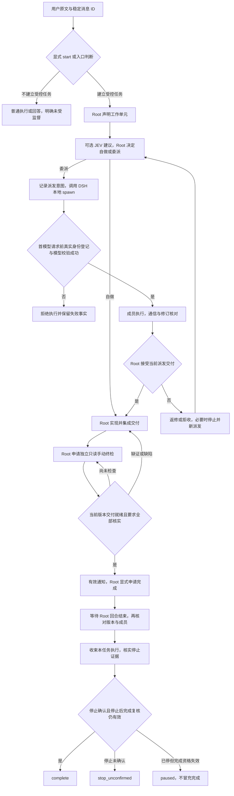

# Orbit 整合 DSH 的协作候选方案

状态：候选方案，2026-10-20。**未确认实施**，不改变现行 ADR、合同、总待办或 Loom 规则。

基线：Orbit 提交 `2c6c3a1`；DSH 版本 `0.2.1-rc.2`，固定提交 `687f282e8625c6b8d11ff58211a90524be2e4317`。本文件没有 DSH 实跑、真实模型探针或性能测量，不能据此宣称 DSH 更快、更稳或更省。

关联：[任务运行合同](../../contracts/task-runtime.md)、[ADR-011](../adr/011-agent-autonomy-and-runtime-responsibility.md)、[OMP 适配说明](../../contracts/host-omp.md)、[宿主接口合同](../../contracts/host-port.md)、[宿主接口与事件通路实施方案](host-port-and-events.md)、[DSH 迁移讨论稿](dsh-migration.md)、[唯一总待办](agent-autonomy-implementation.md)、[交接](handoff.md)、[集成合同](../../contracts/integration.md)。

本文保存多 Agent 调研，并提出 Orbit 复用 DSH 子 Agent 的候选整合方式。它只回答“若做 P3，哪些职责如何落到 DSH”，不授权 P3 实现、安装或发布；产品语义仍只列候选。

后续跨功能源码复核与已认可整合方向见[能力整合专题](dsh-capability-consolidation.md)。其中 C4/C5 补充了 H4/H3 的具体接缝，C7 限定了停止与续接，C11 区分 Team 与独立 worktree 能力；本文件同步这些直接影响协作流程的结论。

## 1. 调研来源与事实边界

采集日期为 2026-10-20。DSH 事实取下列固定提交的一手文档和局部源码；Orbit 事实取当前合同和适配实现。静态核对不能代替 P3 的真实行为探针。

| 固定提交下的来源 | 本文件使用的事实 |
| --- | --- |
| [`docs/subsystems/subagent.md`](https://github.com/deepseek-ai/deepseek-harness/blob/687f282e8625c6b8d11ff58211a90524be2e4317/docs/subsystems/subagent.md) | 子 Agent 的总体定位、本地 spawn/fork 与外部后端的差异 |
| [`packages/subagent/subagent/README.md`](https://github.com/deepseek-ai/deepseek-harness/blob/687f282e8625c6b8d11ff58211a90524be2e4317/packages/subagent/subagent/README.md) | 会话、续接、父子消息与 activation 生命周期 |
| [`packages/subagent/tool-subagent/README.md`](https://github.com/deepseek-ai/deepseek-harness/blob/687f282e8625c6b8d11ff58211a90524be2e4317/packages/subagent/tool-subagent/README.md) | `spawn`/`fork` 工具面、上下文继承、逐子 Agent 路由限制 |
| [`packages/subagent/tool-subagent-control/README.md`](https://github.com/deepseek-ai/deepseek-harness/blob/687f282e8625c6b8d11ff58211a90524be2e4317/packages/subagent/tool-subagent-control/README.md) | `send_message`、`interrupt_agent` 与相邻消息边界 |
| [`packages/subagent/subagent-dsh-sdk/README.md`](https://github.com/deepseek-ai/deepseek-harness/blob/687f282e8625c6b8d11ff58211a90524be2e4317/packages/subagent/subagent-dsh-sdk/README.md) | SDK 外部进程、独立 profile/路由、停止阶梯 |
| [`packages/subagent/subagent-dsh-sdk/src/run.ts`](https://github.com/deepseek-ai/deepseek-harness/blob/687f282e8625c6b8d11ff58211a90524be2e4317/packages/subagent/subagent-dsh-sdk/src/run.ts) | 无 wire prompt cancel；shutdown 后走 EOF/TERM/KILL 回收 |
| [`packages/experimental/agent-team/README.md`](https://github.com/deepseek-ai/deepseek-harness/blob/687f282e8625c6b8d11ff58211a90524be2e4317/packages/experimental/agent-team/README.md) | 实验性 Team：互发、roster、任务板、共享 checkout |
| [`packages/experimental/auto-review/README.md`](https://github.com/deepseek-ai/deepseek-harness/blob/687f282e8625c6b8d11ff58211a90524be2e4317/packages/experimental/auto-review/README.md) | Auto review 是逐工具调用的权限审核，不是交付终检 |

登记事实：

- 本地 `spawn`/`fork` 子 Agent 可以续接；冷恢复需要持久化与 Session query。`spawn` 从新状态开始；`fork` 拿到的是**已完成轮次**的种子，不包含发起 fork 时仍在进行的当前轮，因此不能当作当前工作状态的快照。
- ACP、DSH SDK、Codex、Claude Code 子 Agent 是一次性执行，不能追问或续接；`DSH SDK` 每次启动一个独立进程，有独立 profile、会话、模型路由与工具，父会话只得到最终文本或安全错误。
- 普通子 Agent 的消息只在**直接父子**之间传递：任何活动 Agent 可发给直接可续接子 Agent，只有驻留的可续接子 Agent 可发给直接父 Agent；兄弟和更深后代不是消息目标。实验性 Team 才提供任意成员互发、roster、持久任务板、DAG/依赖就绪与 CAS 任务版本。
- Team 使用**一个进程、一个共享 checkout**，没有 worktree、远程成员、合并或文件系统锁；写入范围提示只是警告，不阻断也不授权写入。Team 是实验性原型，没有稳定性承诺，且不自动释放任务 owner。
- `interrupt_agent` 对本地目标只停当前轮，保留队列与后代，子 Agent 仍可继续；调用返回“受理”，不是目标已安静。外部执行被 interrupt 会永久停止且不能续接，但同样只回受理。完整清理要依赖 `dispose()`：取消精确 activation，等待后代（含待启动者）与资源清理。
- SDK 后端没有 wire 层的 prompt cancel；`dispose` 先本地结算结果，再走协议 shutdown、stdin EOF、POSIX SIGTERM→SIGKILL 的阶梯回收进程。
- `subagent/*` 的观察型通知不能单独满足首模型前登记；但并非所有 DSH 生命周期事件都只能观察。源码确认本地 `agent/created` 是初始化中等待的 serial 事件，失败会回收，已有 H4 候选门；实际模型在稍后的请求准备中绑定，仍须联合验证。来源见[能力整合 C4](dsh-capability-consolidation.md#3-源码复核后的遗漏与修正)。
- Auto review 在每次原生或 PTC 内层工具调用前，用当前 Agent 的 provider/model 评估待执行动作；它没有文件沙箱，模型分类可能放行不安全动作或拒绝有用工作，且 out-of-process 子 Agent 保留自己的权限系统。它不是确定性 H3 门，也不是交付终检。
- 本地 spawn 与 DSH SDK 支持逐子 Agent 指定 `provider`/`model`/`reasoning_effort`；ACP、Codex、Claude Code 拒绝逐子 Agent 选择。当前 fork 工具继承父会话路由，不提供独立子路由，以保留前缀复用。
- Team 的 teammate 可以新起，也可以 fork Lead 的已完成轮次；只有 Lead 能创建或中断 teammate，任务 owner 不因中断、进程退出或失败自动释放。
- 以上均来自固定提交的源码/README，未做运行探针；性能、可靠性、成本和真实停止行为仍是未知。

### 普通子 Agent 与实验性 Team

| 维度 | 普通 spawn/fork | 实验性 Team |
| --- | --- | --- |
| 主要用途 | 单成员执行、可续接的父子协作 | Lead 加具名 teammate 的并行协作 |
| 通信 | 仅直接父子；兄弟/更深后代不可互发 | 任意成员可发给其他成员或 Lead |
| 持久化 | 本地子会话可续接；`fork` 只继承已完成轮次 | roster 与任务板写入 Lead 持久日志，需 durable storage |
| 任务状态 | 无原生任务板 | DAG/依赖就绪 + CAS 版本的任务板；删除保留 tombstone |
| 文件隔离 | 不提供文件隔离；可指定 `cwd`，但不是沙箱 | 共享 checkout，明确无 worktree/lock/merge |
| 模型选择 | spawn 可逐子 Agent 选择；fork 工具继承父路由 | 受 teammate 创建与宿主组合约束，需单独核对 |
| 停止 | 本地 interrupt 只停当前轮；dispose 全量清理 | Lead 可停 teammate 当前轮；任务 owner 不释放 |
| 对 Orbit 的适配 | 最接近“现有成员 + 父子通信” | 可补成员互发，但会引入第二套任务板 |
| 当前建议 | **优先候选** | **待决，不作默认** |

结论：Team 的互发接近当前 OMP `hub` 的通信能力，但任务板不是 `hub`，也不是 Orbit 的工作单元验收记录。Team 仍是实验性共享工作区机制；不能把其 `task completed` 直接映射成 Orbit `accepted` 或任务 `complete`。

### Orbit 受控协作与单独使用 DSH

| 比较项 | Orbit + OMP 的现状与取舍 | 单独使用 DSH 的现状与取舍 |
| --- | --- | --- |
| 执行底层 | 复用 OMP `task/hub`，不是 Orbit 自建调度器；适配依赖宿主钩子 | 自带多后端、会话、容量与生命周期管理；不同后端能力不等价 |
| 分工与模型 | Root 决定，JEV 按角色池提供建议；增加判断调用且质量校准有边界 | 主 Agent 配置/选择子路由，配置较直接；没有等价的 JEV 角色化适配流程 |
| 交付核验 | 要求与产物版本、Root 接受、独立只读终检、逐项证据；检查可能误判且有成本 | subagent 返回执行结果，Team 管协调状态；正常结束或任务板完成不证明需求正确实现 |
| 恢复与上下文 | 受控续接保留原要求与历史，不能继承旧检查资格；协议状态更多 | spawn/fork 与本地冷恢复灵活；外部后端无追问，fork 也会带入父会话假设 |
| 停止 | 任务级汇总 Root、成员、检查进程及后台证据；宿主缺口可能导致未确认 | 提供中断与资源清理原语；调用者仍须区分请求受理、清理结束与任务范围 |
| 适用性 | 适合有独立验收、修订追踪、可信回执需求的交付；简单任务的固定流程成本较高 | 适合直接委派与结果汇总；若需要受控完成语义，还须另接 Orbit 等监督层 |

这些是职责和机制的取舍，不是性能排名。Orbit 当前的检查漏判及真实验证缺口见[缺口清单](debt-ledger.md)；存在监督机制不保证结果正确。上下文隔离、独立进程和不同 `cwd` 也都不自动解决共享文件并发写冲突。

## 2. 职责与实体映射

Orbit 现行规则不变：Root 是唯一入口；团队一层；程序记录事实并执行门控，不代替 Agent 判断交付质量；检查者独立只读；完成与停止分开；执行者与检查者候选池分离；程序不自动更换 Root 型号，用户原生切模能力保留；JEV 只给建议，不自动派发。当前 OMP 原生 `task/hub` 承载派发与成员互发。候选整合把执行与通信映射到 DSH，不复制第二套运行时；Orbit 保留工作单元、监督、选型与检查职责。

| Orbit 实体 | DSH 候选载体 | 必须保持的边界 |
| --- | --- | --- |
| Root | 主会话 | 仍是唯一用户入口和集成者；不因 DSH 外壳另建 Root |
| 工作单元 | 无原生等价物；Orbit 耐久记录 | 目标、输入版本、产物根、依赖、验收、升级条件只认 Orbit |
| 派发 | Root 的原生任务调用 + 子会话绑定 | 一次派发一个成员、一个调用身份、一个实际模型 |
| 执行成员 | 本地 `spawn`（优先）或 `fork` | 成员不能派成员；外部一次性后端不承载需续接成员 |
| 成员通信 | 直接父子消息；Team inbox 仅候选 | 不能无声降级；缺失互发时明确“只经 Root” |
| 独立检查者 | 独立进程中的只读 DSH 会话 | 不是成员，不能直接 `fork` 执行成员 |
| 固定快照 | Orbit 产物快照 | 不用 `fork` 上下文或 Team 共享 checkout 冒充快照 |
| 停止 | 区分 `interrupt` 请求、选定子执行清理与全树 drain | `drainDescendants` 留下 Root admission 关闭标记，不能直接当可逆 pause；其他资源仍须核实 |
| 调用账本 | Orbit 任务记录 | DSH 会话日志是宿主证据，不是账本权威 |
| Loom | 只消费 Orbit 集成合同 | 不要求 Loom 理解 DSH RPC、日志格式或 Team 任务板；合同已有的宿主身份字段仍可携带不透明事实 |

### 工作单元、派发、会话与 activation

这四个概念必须分开，否则“续接”会把旧完成、旧停止或旧模型身份带进新执行。

| 概念 | 含义 | 可复用性 | 禁止 |
| --- | --- | --- | --- |
| 工作单元 `wu-…` | 一项可验收的交付，绑定输入版本、产物根与依赖 | 可在新派发中继续引用，但必须仍为当前版本 | 用 Team 任务板条目替代；旧版本单元直接复用 |
| 派发 dispatch | Root 的一次原生任务尝试，绑定单元、成员、`tool_call_id`、模型与尝试序号 | 同一尝试内通信可继续；输入修改后重新核对单元资格 | 把旧派发的接受、停止或模型身份套到新尝试 |
| DSH 会话 | 子 Agent 的持久会话/事件日志，`spawn`/`fork` 创建 | 宿主可冷续接或复用 | 把会话 ID 当作 Orbit 任务 ID；以会话 idle 宣告任务完成 |
| activation | `startActivation` 管理的一次受管子执行生命周期；创建或冷恢复到结果结算 | 同一会话可多次 activation（续接/冷恢复）；外部执行只有一次 | 停止后的新 activation 仍记作旧派发；不重新确认模型 |

候选绑定规则：

1. 一个派发在其首个 activation 的**首次模型调用前**绑定一个 DSH 会话和该 activation；绑定失败，成员不得使用工具或继续模型工作。
2. 向活动成员送达修订不自行创建新派发，也不自动授予旧单元新版本资格；Root 按现行 `amend` 与工作单元规则处理，记录实际送达，失败记“未送达”。
3. 已确认停止、拒收或失败结算后，旧派发不可续接；恢复执行必须建立新派发和新 activation，重新核对当前输入、产物根、模型与依赖。
4. 若宿主复用同一 DSH 会话承载新派发，必须重新绑定并重新确认实际模型；会话历史只能作为上下文，不能继承旧派发的完成资格。
5. DSH 的实际执行事实与 Orbit 记录不一致时，保留冲突来源并重新核实；不能因 Orbit 缓存写了 `completed` 就忽略仍在运行的宿主。Orbit 拥有交付与完成判定，宿主拥有实际执行事实；无法核实则保持未知或停止未确认。

这里的 activation 关联是适配层待设计的身份映射，不承诺 DSH 已提供可持久化的公共 `activation_id`。后续须证明一次执行与其停止句柄精确对应，不能仅凭可复用的 session ID 归因。

“预留 ID”不等于登记：先创建 session ID、先分配 `orbit-<uuid>` 或先写入期望模型，都只是准备动作。H4 要求的是**首个 provider 请求前同步、耐久、可回读的登记**，失败即中止。

## 3. 目标流程

流程要点：

1. **入口**只决定是否建立受控边界。自动入口须在首模型请求前取得用户原文与稳定 ID；显式 start 与外部集成关闭自动 JEV 的路径保留。JEV 不可用不等于拒绝所有普通执行，明确受控请求也不能静默退成未受控执行。
2. **工作单元**由 Root 声明，包含目标、要求引用、上下文/决定、范围、验收、依赖与升级条件。`execution=root` 的单元不进入成员队列。
3. **选型**保留角色池、可用目录、实际路由与授权交集。JEV 有效时给建议；未启用、无有效放行或不可用时按现行规则显示事实与局限，Root 决定下一步。严格外部集成关闭 JEV，不强塞角色池。DSH 路由白名单不能替代 JEV，也不能扩大 Orbit 授权。
4. **派前准备**持久化单元、输入版本、产物根、依赖与期望模型。子会话已有真实身份但尚未发出首个 provider 请求时，同步登记并校验实际模型；记录失败、身份漂移或绑定失败就阻断。准备记录不是 H4，会话创建后的可阻断窗口能否提供仍待验证。
5. **执行**优先本地 `spawn`。需要继承已完成上下文时才考虑 `fork`；`fork` 不继承当前轮，不能当作当前工作快照。
6. **通信**记录实际发送者、目标、派发、会话及可得消息 ID；接受回执不等于模型已处理。Root 判断用户新消息是否是有效修订，显式 `amend` 后按现行规则更新版本并通知相关活动成员；未送达如实记缺口。O1 未启用时只能明确声明经 Root 中转，不能假装成员互发。
7. **接受与拒收**核对当前版本的真实持久交付，不把 DSH `completed`、idle 或 Team 任务状态当作业务接受。Root 可继续要求活动成员返修；决定结束旧派发再重派时，须先核实旧执行停止，保留尝试历史。
8. **独立检查**使用独立进程、只读工具和受检快照；还可按现行授权读取登记的实时产物、会话与证据，注明来源和版本。检查者不修改产物，也不从执行者自述推导通过。
9. **完成**要求有效的当前版本手动 reviewer 链、完整要求枚举、交付项全部 verified、交付就绪、无开放 finding/待核对线索、成员结算与检查清理可核实。无 finding 或 schema 合法均不充分。Root 显式申请完成，等待回合正常结束；停止前后均复核版本和成员范围。
10. **停止**保留 Root 会话与上下文，停止的是执行而非删除会话。核实 Root 与成员无在途工具、名下后台实际结束、当前任务的消息与延迟唤醒已处理；不得清空其他任务或用户的消息。检查进程另行回收。未知保持 `stop_unconfirmed`；已停止但完成资格失效则 `paused`。

## 4. H1–H7 与可选通信接缝

H1–H7/O1–O4 的编号取自仍为提议的[宿主接口合同](../../contracts/host-port.md)与[实施方案](host-port-and-events.md)；现行约束以任务运行合同为准，不以此文采纳 ADR-014。下表只给 DSH 候选接缝与探针通过信号，**均未实证**。凡普通路径、Team、SDK 或其他入口可创建执行，都须纳入同一登记和权限门，不能只包一层工具而漏掉旁路。

| 编号 | Orbit 义务 | DSH 候选接缝 | 探针通过信号 |
| --- | --- | --- | --- |
| H1（可选） | 首个模型请求前看到用户消息与稳定 ID，可提示或中止 | `agent/pre-step` 或会话创建/首消息窗口 | 未完成入口判断时没有 provider 请求；拒绝后模型不发生；显式 start 仍可用 |
| H2（必需） | 每次请求投影有效要求；每轮注入状态摘要 | 请求组装、`agent/pre-step` 消息替换或宿主上下文注入 | 连续两次请求含当前要求版本与修订；修订后旧文本不再冒充当前；摘要不写入用户消息 |
| H3（必需） | 工具调用前拦截：成员不能派成员、路径/命令范围、模型授权 | DSH `tools.restrict` 与 pre-execute 后单调拒绝的 `tools.guard`；异步范围准备另接入 | native/PTC 等实际入口均被守卫；另层 allow 不能绕过拒绝；越界与模型漂移不执行 |
| H4（必需） | 成员首次模型调用前同步登记，失败即中止 | 本地 `agent/created` 初始化门 + 请求准备后的实际路由核对；不能以观察通知或外部 backend start 回执代替 | 强制登记失败时零 provider/工具调用；持久记录可回读，实际模型一致。首批受控成员排除未满足 H4 的外部后端，不以降级冒充必需能力 |
| H5（必需） | 停止并确认：空闲、无在途工具、名下后台结束、任务消息处理 | 任务级入队门、选定成员清理、Root 与 jobs 核实、检查进程回收；不直接用全树 drain 代替 pause | 当前任务已停、其他消息保留、迟到唤醒不复活旧任务；同 Root 后续合法新任务仍可派发；未知则不确认 |
| H6（必需） | 每次模型与工具调用回执：实际型号、用量、时间 | 实际请求/usage 投影及 `llm/stream`，覆盖标题等非 loop 调用；provider 的 prepare/connect 另核 | 实际身份与绑定一致，漂移拒绝，缺 usage 记 unknown。目录/认证 HTTP 不算 token 推理；流式门不是所有 provider 最早的凭据/I/O 门 |
| H7（必需） | 隔离只读检查者：独立进程、只读工具、固定快照 | 另起只读 DSH 会话/进程，加载检查 profile | 检查进程独立；写工具被拒；快照摘要稳定；读取来源与版本可追溯 |
| O1（可选） | 成员之间互发消息 | 普通子 Agent 仅直接父子；Team inbox 候选 | 启用时消息真实送达；未启用时界面/账本明确“只经 Root”，不静默假装已互发 |
| O2（可选） | 向活动成员转发用户修订 | 本地 spawn/fork 的后续 `send_message`；外部一次性后端不支持 | 活动成员收到修订并回执；未送达记未送达；外部后端明确不可续接 |
| O3（可选） | 原生提问的跳过追踪与补问提醒 | 宿主 ask/interrupt 事件 | 跳过被记录，Root 可重问；不把跳过当已提问成功 |
| O4（可选） | 与系统指令同层的合作政策注入 | system/developer 同层注入点 | 政策可见且不落在用户消息尾；不可注入时不宣称已告知 |

边界：

- **H4 不能只靠观察型通知，但已有本地同步候选门。** `agent/created` 被初始化等待并可抛错回收；它区别于 `subagent/*` 观察通知。创建时身份、后续实际路由、登记耐久性以及外部后端仍须逐入口验证，不能把事件到达当成完整 H4 证据。
- **H5 不能由 interrupt、session/wait 或 job 终态满足。** `drainDescendants` 保留 Root 的关闭标记直到 disposed；`session/wait` 不等后台资源，job 的 producerReported 不证明资源释放。先封本任务新执行，再收束成员及在建执行、Root、jobs、迟到答复/消息/自动唤醒和检查进程；选定子执行清理本身不够。不全清用户消息，不为恢复派发擅自销毁 Root 上下文。联合结论及源码见能力整合 C7。
- **H3 不能由 Auto review 满足。** Auto review 是逐工具调用的模型分类，可能放行不安全动作，且没有文件沙箱；它只能作为附加权限层，不能替代确定性的工具拦截。
- **H7 不能用 fork。** fork 继承执行上下文，不是独立只读检查。DSH SDK 的一次性外部进程可作为隔离候选，但它只把最终文本/安全错误交回父会话，工具轨迹留在子进程；需要额外回执投影才能证明“只读”与逐项覆盖。
- **SDK 没有 wire 层 prompt cancel。** 不能把 abort 信号当作模型已停止；必须在本地结算结果后，按协议 shutdown、EOF、TERM、KILL 阶梯确认进程与后代退出。ACP/Codex/Claude Code 是外部一次性执行，停止能力按其原生权限与传输，不能假定与本地相同。
- 当前没有 DSH 探针结果，不能把 H4/H5 写成“已支持”，也不能把 H1–H7 的候选接缝写成已实现。
- **受控 profile 与调用前准备也在边界内。** 固定有效插件/配置，首批探针不启用独立 Goal/schedule 驱动、动态插件/HMR、未授权标题调用/上传及 workflow/PTC；checker 保持最小只读面。正式切换不能据此静默删减既有能力。Account 路由的 prepareCall 可提前认证/查目录，不能只守 agent loop 或把 llm/stream 当最早出站门；详见[联合方案与 C14/C15](dsh-capability-consolidation.md)。

## 5. 失败、迟到、暂停与续接

### 失败重派

成员以真实原生错误结束且无在途工作时，程序可记录该派发失败；Root 决定补输入、重试、换人或结束路径。重派建立新派发，保留旧尝试的结果、模型、用量与失败原因，不删除历史，不把一次失败变成永久型号黑名单。若 DSH 子会话已 dispose，重派必须新建会话或显式冷续接；无论哪种，都要重新做首模型前登记与实际模型确认。

### 迟到消息

DSH 会话可能在新派发开始后送达旧 activation 的消息、结果或后台回执。处理规则：

1. 每条消息按派发、会话、activation 和 `tool_call_id` 归属；归属不可证时记未归属，不并入当前工作单元。
2. 旧派发已拒收、已停止或已被新尝试取代时，迟到结果只留证，不自动唤醒 Root、不自动 accepted、不取得当前检查资格。
3. 已确认停止的成员不能被旧消息重新唤醒；发送失败或消息无法清出队列时，停止保持未确认。
4. Root 收到迟到消息后先核对版本与身份；需要采用旧产物时重新验证其对当前要求的适用性，再按现行规则接受与检查。重新执行须建立新派发；只有真实用户修订才可 `amend`，不能用采用旧产物伪造修订来源。
5. 中断后、目标真正 idle 前接受的消息可能停在队列，直到另一次唤醒发送；不能当作已处理。崩溃时已接受但未写入子会话日志的消息不会自动重放；这类丢失必须显式记为缺口。

### 暂停与续接

暂停停止当前 activation、后代和后台工作，保留 Root 会话与上下文。续接不是把旧 dispatch 复活：

- 仅在旧任务已确认停止、同一 Root 收到有效用户续接指令时，通过新任务/`resume_from` 建立新边界；旧任务保持终态，保存原要求、有效修订和最新原生消息来源。
- 新任务重新拍快照、重新登记成员、重新选择检查者；旧成员、旧检查、旧用量不迁入新任务。
- DSH 本地会话可续接，但续接后的 activation 属于新派发；必须重新确认模型、输入版本和产物根。
- 用户尚未再次发言时不自动重启；明确暂停、讨论或取消优先；独立问题只回答，不自动接回原交付。

### 旧 OMP 任务不能跨宿主 resume

旧 OMP 任务不能通过现有 `resume_from` 在 DSH 上继续：该接口要求同一 Root 会话。Orbit 的历史任务、导出与证据仍可读，不能因换宿主删除。若以后决定继续旧目标，应先确认 OMP 执行已停，再由用户有效指令在 DSH 创建独立新任务；旧资料可作为明确指定的依据，但不继承成员、检查资格、用量或停止回执。跨宿主关联字段或公开续接协议尚未设计，本方案不宣称已有该能力；若需要，先按集成合同兼容规则另行决定。

## 6. 推荐与不推荐

**建议（候选）：先评估本地 `spawn` 承载 Orbit 成员。** 它可续接、可逐子 Agent 选模型，也不必引入实验性 Team 任务板；但默认共享目录同样没有自动文件隔离。此建议适用于明确接受 O1 只经 Root 的试验范围，不代表与当前成员互发能力等价。`fork` 仅在继承已完成上下文确有价值、且父路由符合成员选型要求时考虑。

**Team 待决。** 只有在需要成员互发且普通父子通信不足时才评估 Team；采用前必须证明互发、roster、任务板、DAG/依赖、CAS、共享 checkout 和停止语义，并明确 Team 任务板不是 Orbit 工作单元权威。共享 checkout 没有文件隔离，写入范围只是警告，不能据此宣称并行写安全。

**Peer 通信不能无声降级。** O1 不可用时，按已采纳的宿主能力策略显式关闭并标明只经 Root；当前分级仍属提议，P3 试验可记录限制，正式切换前必须确定是否满足既有协作要求。Team 是候选补足方式，不因方便就另造自定义 hub。

**Checker 必须独立进程、只读，不能直接 fork 执行成员。** `fork` 继承已完成执行轮次，既不独立也不只读，还会把执行上下文带进检查。检查者读取固定快照和登记材料，使用写工具必须被拒绝。

**凭据不入账本。** DSH 的凭据引用由宿主解析，SDK 子进程使用去掉凭据的父环境再加显式配置；Orbit 只记录实际 provider/model、调用身份和可得用量，不保存 API key、token 或私有凭据文件。

**不要双任务/生命周期权威。** DSH 管真实会话、activation、消息和资源清理；Orbit 管要求、工作单元接受、检查资格、任务完成与停止证据汇总。两者记录的是不同事实。冲突必须重新核实，Orbit 不用自己的旧状态覆盖 DSH 仍在执行的事实；Team 任务板也不能直接修改 Orbit 的验收结论。

**Loom 仍只消费 Orbit 合同。** 不要求 Loom 解析 DSH RPC、事件格式或 Team 任务板。集成合同已允许的 provider/session 身份可继续作为不透明字段；不得把“隔离宿主细节”误写为删除已有公开字段。凭据不进入该接口。

## 7. 待决事项

1. 何时启动 P3。当前仅获准备授权；原方案“不进入生产、不接 Loom”的试验边界保留，若要改变范围另行决定。
2. 入口落点：会话创建、首条用户消息，还是显式 start；`agent/pre-step` 能否在首请求前拿到原文与稳定 ID。
3. 成员载体：普通 `spawn` 为默认，`fork` 的适用条件（尤其 fork 工具不能独立选路由），以及是否需要 Team。
4. O1/O2 的降级策略：只经 Root 时如何在状态与账本中显式标注。
5. H4 的本地初始化门与实际 route 守卫如何组合；如何证明登记发生在首 provider 请求之前，外部一次性后端如何满足同一义务。
6. H5 对本地、SDK 与其他后端的停止证据；Root admission 关闭标记、在建成员、迟到答复和队列范围，以及保留 Root 后合法续接。
7. 检查者的独立进程、只读 profile、快照与模型解析；复用宿主合法凭据解析能力，不复制凭据到记录，也不把同账号误认为缺少会话独立性。
8. 同一工作区并行修改如何由 Root 协调与核验。当前不新增自动 worktree 隔离；只有出现无法承接的真实需求时再讨论方案。
9. DSH 会话/activation 事实与 Orbit 调用回执的精确归属，尤其外部一次性后端的可观测缺口；不另建泛化遥测或保留策略。
10. 差分验收的任务集、比较维度与真实模型样本；确定性测试不能替代真实停止与纠偏验证。

## 8. 未验证与风险

- 没有 DSH 实跑、没有 H1–H7 探针、没有性能/可靠性/成本数据；本文件不宣称 DSH 优于 OMP。
- H4、H5 尚未被证明可在 DSH 上满足；observe-only 事件和 interrupt 受理都不构成通过证据。
- Team 是实验性能力，共享 checkout 无文件隔离；任务板写入范围只是警告，且不自动释放 owner，任务板语义可能随版本变化。
- `fork` 只继承已完成轮次；用它复制当前执行状态会得到不完整上下文。当前 fork 工具也不能独立选择子模型路由。
- ACP、DSH SDK、Codex、Claude Code 一次性、无追问；SDK 无 wire prompt cancel，只能靠 shutdown/EOF/TERM/KILL 回收。
- Auto review 是模型权限审核而非交付终检；它没有文件沙箱，可能误判，且 out-of-process 子 Agent 不继承它。
- Team/子 Agent 的 owner、residency 与 inbox 是进程内的；跨进程共享一个持久化存储需要额外 mailbox 与 lease，当前不保证。
- 没有 durable parent mailbox；父 Agent 不在时子到父消息会被拒绝，不能当作已送达。
- 凭据解析、模型目录与实际可用性必须在隔离环境中预检；目录可见不等于账号可用。

## 9. 资料退场条件

本文件保存迁移决策仍依赖的事实与候选，不新建产品权威：

1. 已采纳结论进入所属 ADR/合同、已验证事实进入交接或验证记录、未完成事项进入唯一总待办后，再核对入链并退场；存在未吸收的研究问题时不因某个探针通过就整篇删除。
2. DSH 版本、Orbit 合同或相关 API 改变时，重新核对受影响结论，保留固定版本来源；旧结论不能直接为新版本背书。
3. 链接不可访问时明确来源缺口，不把摘要当成新证据。退场后的历史通过 Git 取回，不另建永久过程档案。
