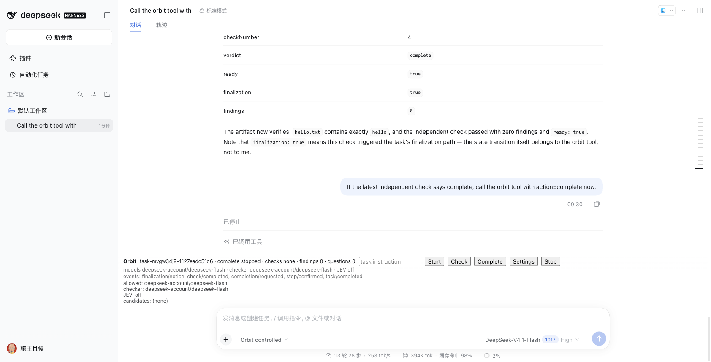

# C1 Orbit React 面板（第一版）

已验证（真实 DSH Web + 隔离 profile，ego-browser 复用同一 tab）：

| 操作 | 结果 |
| --- | --- |
| Start | 从面板输入 instruction，新任务 `running` |
| Stop | `paused stopped`，停止确认生效 |
| Check | 事件出现 `check/requested → check/completed`，open findings 更新 |
| Complete | 检查 ready 后点击，任务 `complete stopped`，事件含 `completion/requested, stop/confirmed, task/completed` |
| Settings | 只读显示 allowed models、checker 路由、JEV、候选池 |

面板每 2 秒读取同源 `/orbit/api`；工具调用在对话流中已以 Orbit 工具卡片呈现。

未完成：
- 可编辑设置（JEV key/候选池/允许模型）。
- 独立的对话流 Orbit 事件行（当前是工具卡片 + 面板内最近事件）。
- 客户端构建的仓库内可复现集成。

## 追加：可编辑设置（2026-10-21）

- 设置卡输入框加 aria-label 后，用 ego-browser 修改 allowed models 并 Save：
  - 面板立即显示 `models test-provider/test-model`；
  - `$DSH_HOME/orbit-settings.json` 持久化为同一值；
  - 宿主重启时加载该文件。
- 可编辑项：allowed models、checker provider/model、JEV endpoint。
